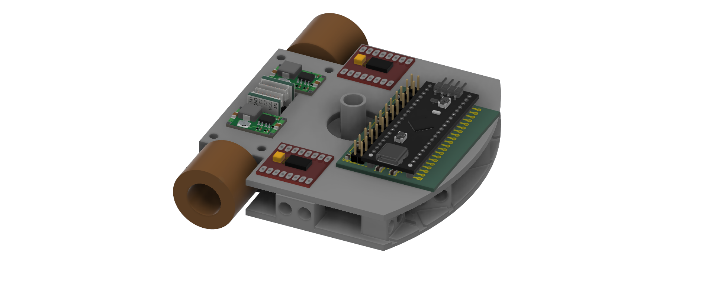
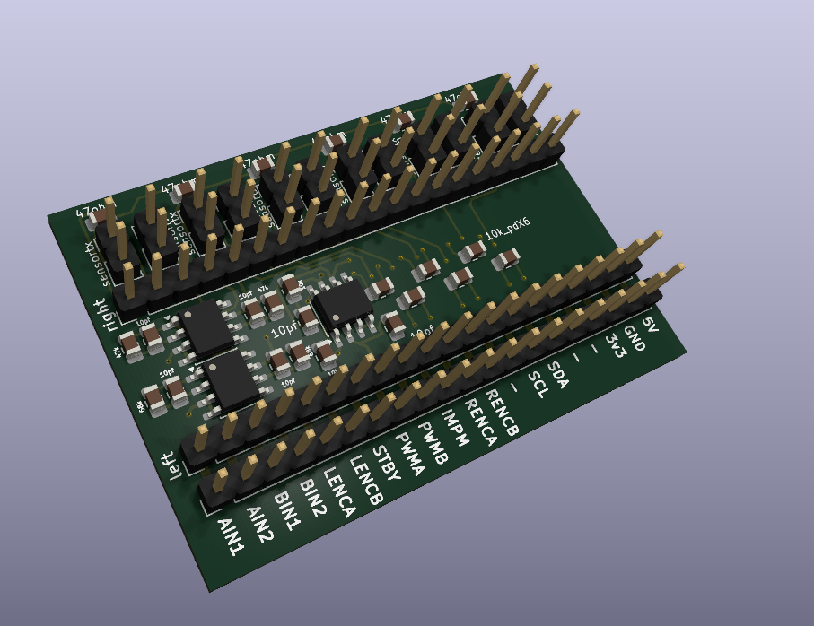
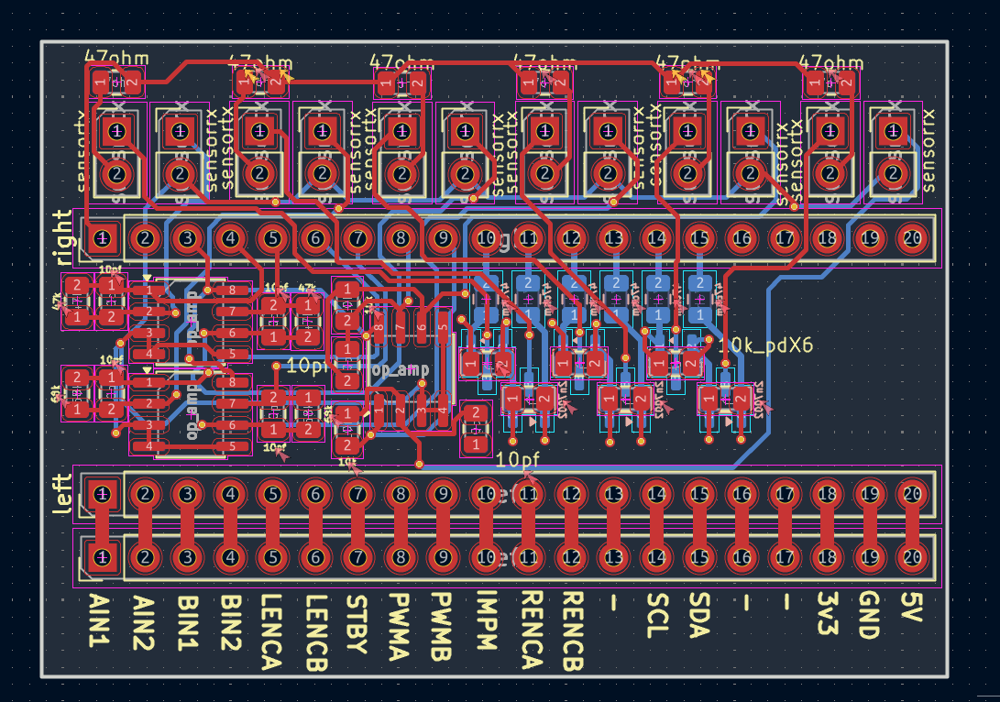
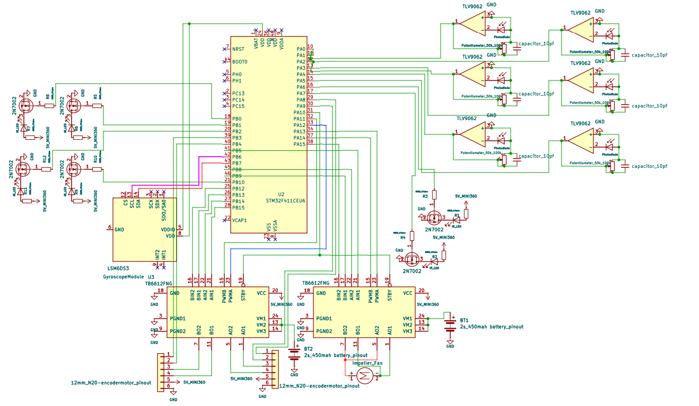

# Micromouse - Autonomous Maze Solving Robot

An autonomous Micromouse robot that is  capable of navigating and solving a maze with high speed and efficiency with custom 3D-printed suction components.

## Required Library Setup 

Go to  File-> Preferences-> Additional Boards Manager URL in Arduino IDE and paste the link below:
https://github.com/stm32duino/BoardManagerFiles/raw/main/package_stmicroelectronics_index.json

## Key Features

* 6 Fully Custom-Designed IR sensors
* Custom made PCB  compatible with the STM32 Blackpill including the already-made pin layout for all components and the components for the IR sensor circuit
* Advanced PID for wall centering, soft turns, path smoothing and other features
* STM32 Blackpill board 
* 3D printed Case with 6 sensor brackets and motor holders with 2 layers, weighhing about ~50 Grams (The impeller suction force nearly eliminates the weight of the chassis in turns and adds more grip on straight runs.)

## Technical Overview
Brain: STM32 Blackpill Microcontroller for sensor data acquisition and motor control.
Motors: N20 12mm 2000rpm motors with built in encoders.
Wheels: 21x14mm jsumo silicone wheels for maximum grab and control over the corner-turns.
Motor drivers: TB66FNG motor driver for the impeller and the motors
Impeller fan: 720 coreless motor and 30-mm wide 9-wing impeller for ~50gr of suction power
6 Fully-Custom IR sensors: Working in analog with op-amps for noise eliminating and voltage amplifying

## Hardware & PCB Design

The PCB was designed in kicad With the help of datasheets of the components.
You can see the PCB below:

 
## Schematics 

The schematics was designed in kicad. Conn_xx-xx connectors were used to take place of the custom parts such as the motors.

Image Below:

# CAD & Mechanical Designs of the Project Micromouse

This folder called `/cad` contains the 3D mechanical models, CAD source files, and 3D-printable STL files for the Micromouse project (designed in Autodesk Fusion 360).

### File Structure & Descriptions are written in here:

#### 1. Vacuum Fan Assembly (Suction System)
* **`impeller_blade.step` / `impeller_blade.stl`**: 9-vane backward-curved 30mm impeller designed for high-RPM airflow and optimal downforce with a 720 coreless motor.
* **`impeller_bracket.step` / `impeller_bracket.stl`**: Vacuum casing housing with an integrated 7.15mm press-fit motor mount and 3 mounting legs for chassis integration.

#### 2. Full Chassis & Robot Design
* **`micromice_lightning.step`**: Complete assembly STEP file of the Micromouse robot chassis.
* **`micromice_lightning CAD.png`**: High-resolution 3D preview render of the robot design.

## Repository Structure
`/cad` contains all STL files (chassis, impeller, and motor mounts)

`/pcb` contains the KiCad schematic and PCB board file such as png and .kicad files.

`/firmware` contains the STM32 source-code for PID motor control, IR sensing and the Floodfill algorithm(read down there)

## Bill of Materials (BOM) files
- [BOM.csv](bom/BOM.csv) - The main BOM file 
- [BOM_ozdisan.csv](bom/BOM_ozdisan.csv) - The BOM file for the custom IR sensor 
- [BOM_ozdisan.pdf](bom/BOM_ozdisan.pdf) - The PDF version / datasheet for the custom IR sensor (The pdf version of the IR sensor file.(downloaded from the website, its raw and half turkish.)

